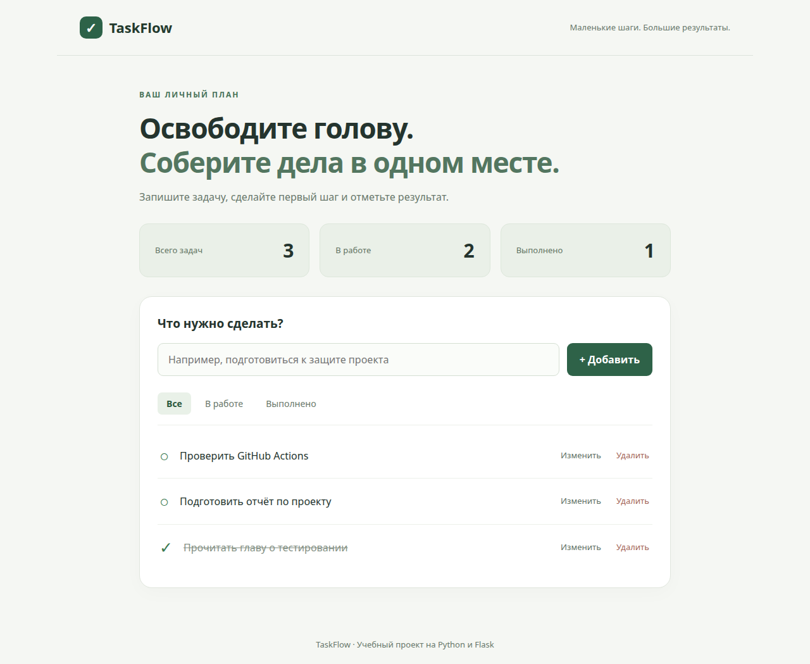

# TaskFlow 🌿

Небольшой планировщик задач на **Python + Flask + SQLite**. Учебный проект с понятной архитектурой, тремя уровнями тестирования и CI/CD в GitHub Actions.


## Что умеет приложение

- Добавлять и редактировать задачи (название до 120 символов).
- Завершать задачи и возвращать их в работу.
- Фильтровать список: все, в работе, выполнено.
- Удалять задачи и показывать статистику.
- Сохранять данные между перезапусками в SQLite.
- Работать на компьютере и телефоне без внешних шрифтов и JavaScript.



## Быстрый запуск

Нужен Python **3.11 или новее**. Команды выполняются из папки проекта.

```bash
python -m venv .venv
```

Активируйте окружение:

```bash
# Linux / macOS
source .venv/bin/activate

# Windows PowerShell
.venv\Scripts\Activate.ps1
```

Установите зависимости и запустите приложение:

```bash
python -m pip install -r requirements.txt
python -m flask --app app run
```

Откройте **http://127.0.0.1:5000**. База `instance/tasks.sqlite` создаётся автоматически. Не требуется отдельный сервер БД или ручная подготовка схемы.

Для локальной разработки используется стандартный ключ сессии. При развёртывании задайте свой `SECRET_KEY`. Приложение рассчитано на одного пользователя: регистрации и разделения задач между пользователями нет.

## Тестирование

```bash
python -m pip install -r requirements-dev.txt
python -m playwright install chromium
pytest --cov=app --cov-report=term-missing --cov-report=html
ruff check .
```

На Linux при отсутствии библиотек браузера: `python -m playwright install --with-deps chromium` (установка системных библиотек может требовать права администратора).

Можно запускать уровни отдельно:

```bash
pytest -m unit
pytest -m integration
pytest -m system
```

| Уровень | Что проверяется | Инструменты |
| --- | --- | --- |
| Модульный | Проверка названия и фильтров без веб-сервера и БД | pytest |
| Интеграционный | Маршруты Flask вместе с реальной временной SQLite, ошибки, CSRF, сохранение данных | pytest + Flask test client |
| Системный | Полный путь пользователя через Chromium и настоящий HTTP-сервер, включая мобильную ширину | pytest + Playwright |

Каждый тест получает отдельную временную БД. Системные тесты сами запускают сервер на свободном порту и закрывают его после выполнения. Рабочие задачи не затрагиваются. Порог покрытия в CI — **90%**, включая ветвления.

Подробности: [план тестирования](docs/TESTING.md), [результаты локальной проверки](docs/TEST_RESULTS.md).

## CI/CD

Workflow [`.github/workflows/ci-cd.yml`](.github/workflows/ci-cd.yml) выполняется при push в `main`, pull request в `main` и ручном запуске.

1. **CI:** установка зависимостей, проверка Ruff и все три уровня тестов на Python 3.11, 3.12 и 3.13.
2. Сохранение JUnit и отчёта покрытия в артефактах GitHub Actions.
3. **CD (continuous delivery):** после успешных проверок push в `main` сборка Docker-образа и публикация в GitHub Container Registry (`ghcr.io`). Теги: `latest` и SHA коммита.

Публикация использует встроенный `GITHUB_TOKEN`: отдельный токен в коде не нужен. GitHub Actions и запись пакетов должны быть разрешены настройками репозитория/организации. Ошибка любого задания с тестами блокирует публикацию. Pull request и ручной запуск образ не публикуют.

Это автоматическая доставка готового образа. Автоматическое развёртывание на внешнем сервере не настроено: для него нужен выбранный сервер. Веб-приложение на GitHub Pages не размещается, поскольку Flask нужен работающий Python-сервер.

## Запуск через Docker

```bash
cp .env.example .env
# Откройте .env и замените SECRET_KEY собственной случайной строкой.
docker compose up --build -d
```

Откройте **http://127.0.0.1:8000**. Gunicorn обслуживает запросы, volume `taskflow-data` хранит SQLite между пересозданиями контейнера.

```bash
docker compose down
```

Эта команда сохраняет volume. Для использования опубликованного образа вместо сборки см. [инструкцию публикации](docs/GITHUB.md).

## Как устроен код

```text
app/
  __init__.py       создание и настройка приложения
  db.py             соединение SQLite и создание таблицы
  validation.py     чистые функции проверки данных
  routes.py         HTTP-маршруты и SQL-запросы
  templates/        HTML-шаблоны Jinja2
  static/style.css  адаптивное оформление
 tests/
  unit/             модульные тесты
  integration/      интеграционные тесты
  system/           браузерные тесты
```

В учебном проекте SQL находится в маршрутах: это позволяет проследить весь путь запроса без лишних слоёв. Во всех запросах данные передаются через параметры `?`. Jinja2 экранирует HTML, а Flask-WTF защищает изменяющие запросы от CSRF. Изменения выполняются только через POST.

Есть endpoint `/health`, который проверяет доступность базы. Фабрика `create_app()` позволяет создавать независимые приложения с разными настройками для тестов.

## Материалы для сдачи

- [Разбор проекта и сценарий защиты](docs/DEFENSE.md).
- [Требования и план тестирования](docs/TESTING.md).
- [Публикация на GitHub и проверка Actions](docs/GITHUB.md).
- [Результаты проверки](docs/TEST_RESULTS.md).

## Источники

Реализация опирается на официальную документацию: [Flask: тестирование](https://flask.palletsprojects.com/en/stable/testing/), [Flask: SQLite](https://flask.palletsprojects.com/en/stable/tutorial/database/), [GitHub: публикация Docker-образов](https://docs.github.com/en/actions/tutorials/publish-packages/publish-docker-images).

Лицензия: [MIT](LICENSE).
